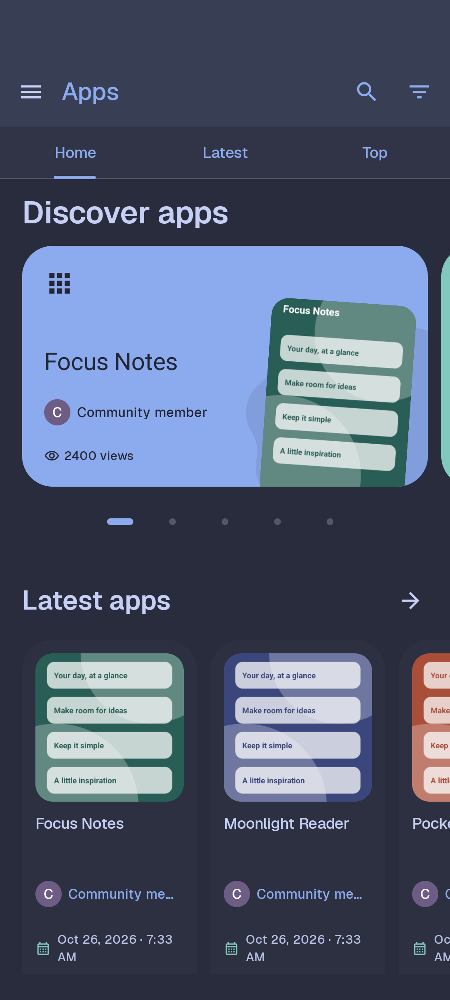
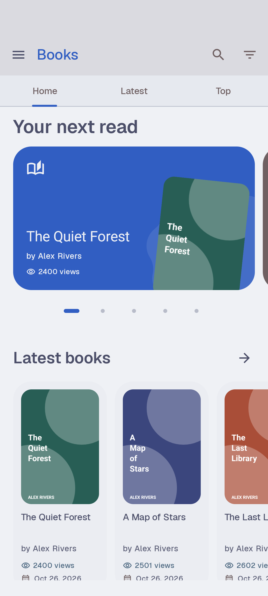
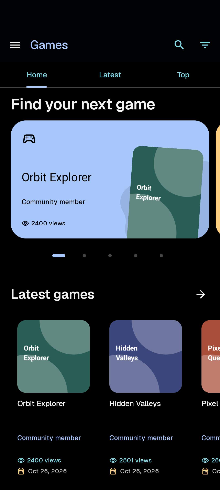
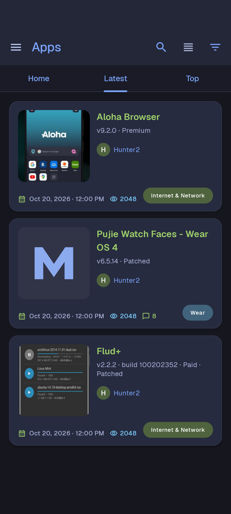
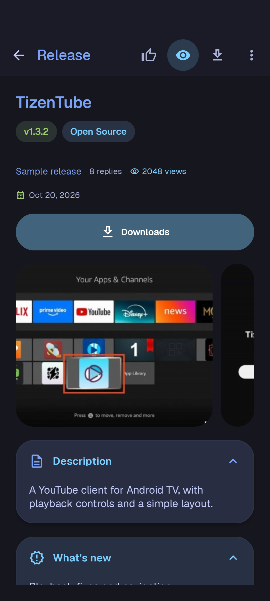
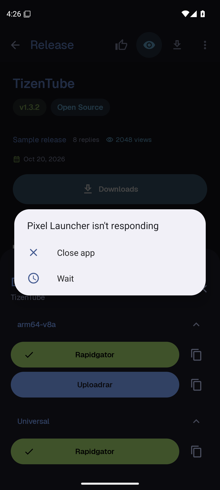
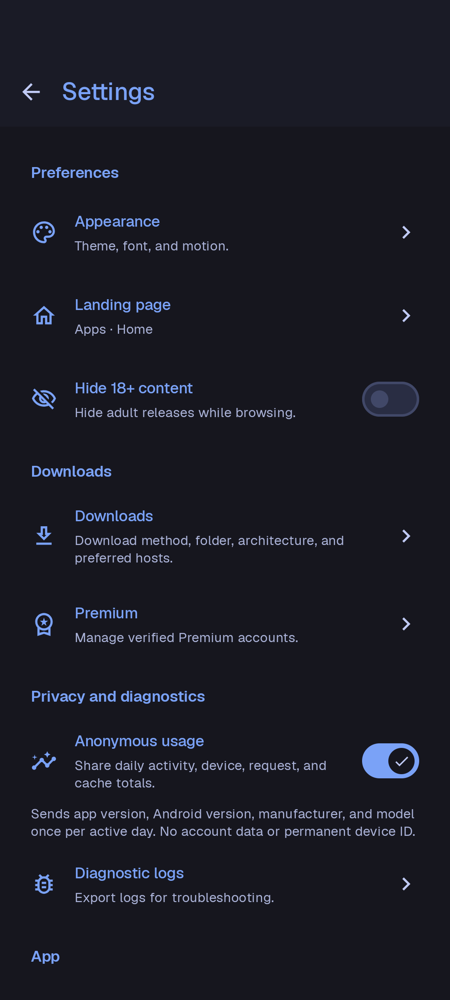
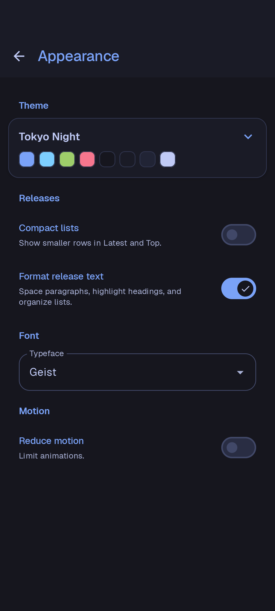

# Mobilism Material

Modern Mobilism Android client rewritten in Kotlin and Jetpack Compose. Built with Material 3 Expressive components and motion.

<div align="center">

[](https://github.com/LosLonelyDevs/Mobilism-Material/releases/latest)
[](https://github.com/LosLonelyDevs/Mobilism-Material/releases)
[](https://github.com/LosLonelyDevs/Mobilism-Material/actions/workflows/ci.yml?query=branch%3Amain)
[](https://github.com/LosLonelyDevs/Mobilism-Material/releases/latest)
[](LICENSE)

</div>

<p align="center">
<a href="https://github.com/LosLonelyDevs/Mobilism-Material/releases"></a>
<a href="https://apps.obtainium.imranr.dev/redirect?r=obtainium://app/%7B%22id%22%3A%22cum.ahfu.mobi.material%22%2C%22url%22%3A%22https%3A%2F%2Fgithub.com%2FLosLonelyDevs%2FMobilism-Material%22%2C%22author%22%3A%22LosLonelyDevs%22%2C%22name%22%3A%22Mobilism%20Material%22%2C%22additionalSettings%22%3A%22%7B%5C%22includePrereleases%5C%22%3Atrue%7D%22%7D"></a>
</p>

The Obtainium button includes prereleases.

Still a work in progress. Requires Android 8+. Installs alongside the old app and keeps its own data.

## Screenshots

<p>
  
  
  
</p>
<p>
  
  
  
</p>
<p>
  
  
</p>

Screenshots use sample data. CI refreshes them on version bumps and screenshot test changes.

## Features

- Browse Apps, Books, and Games. Filter by category or date and see what's new since your last visit.
- Follow the apps you care about and get notified when someone posts a newer version.
- Read what changed, check the mod info, and jump straight to downloads. Release pages put each in its own section.
- Connect Mobilism Premium, Real-Debrid, or MegaDebrid to download from supported hosts and unpack archives into your chosen folder. Other file links open in your browser.
- Reply to comments, join forum discussions, and send private messages. You can share a link to a specific reply or turn on alerts for incoming messages.
- Pick a theme, match your wallpaper colors, or use AMOLED Black. You can also change the font and reduce motion.

[More features](docs/notable-features.md) · [Usage reporting and opt-out](services/daily-usage/README.md) · [Troubleshooting](docs/troubleshooting.md)

## Requesting Features For Paid Services

I've gotten a lot of requests to add support for paid services. I'm one engineer working on this app in my spare time. I won't buy a subscription just to build a requested integration. If it's a service I don't already use, please be prepared to provide a development account and keep it active long enough for me to build and test with it.

Providing an account gives me a way to try the service. I can't promise the integration is possible, that I'll build it, or when it would ship. If those terms don't work for you, the project is open source. You're welcome to build the integration yourself and send a pull request.

## Build

Use JDK 21 and Android SDK 37. Set `ANDROID_HOME` or `sdk.dir` in `local.properties`.

```powershell
./gradlew.bat :app:assembleDebug
```

On macOS/Linux: `bash ./gradlew :app:assembleDebug`. APKs go to `build/apk/`.

CI runs tests, lint, and a build. Bump `versionName` and `versionCode`, then push to `main` to publish a signed release with checksums, marked Latest on GitHub. [Release workflow](.github/workflows/release.yml).

[Verification](docs/verification.md) · [Themes](docs/themes.md) · [Migration](docs/migration.md)

## License

[AGPL-3.0](LICENSE). Bundled fonts use the [SIL Open Font License](docs/font-licenses.md). [Third-party notices](THIRD_PARTY_NOTICES.md).
