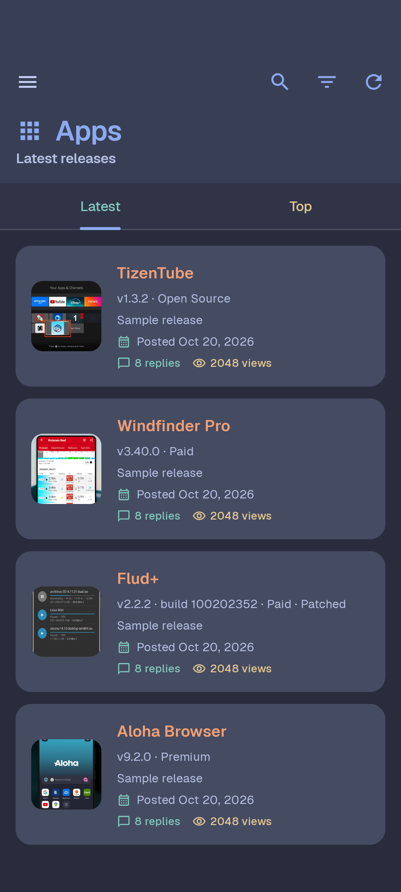
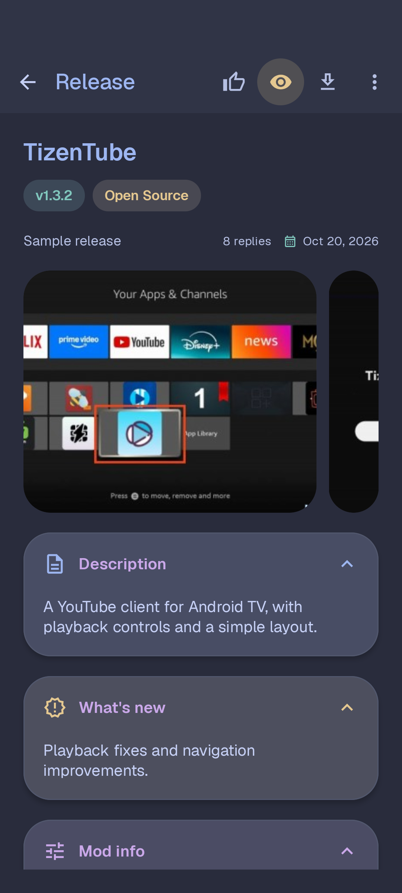
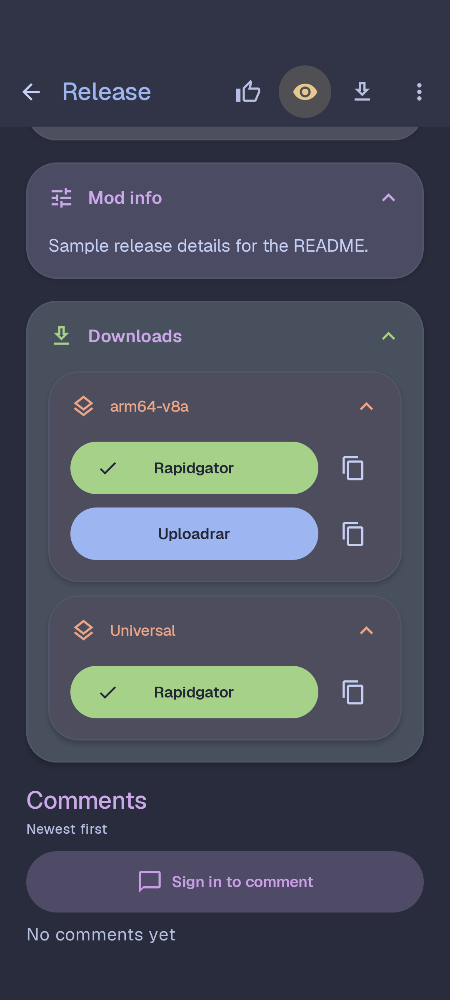
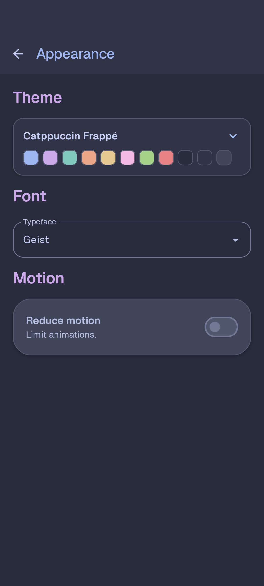

# Mobilism Material

I'm rebuilding Mobilism in Kotlin and Jetpack Compose. Same basic flow, with Material 3 Expressive components and motion. Catppuccin Frappé and Geist are the defaults.

<p>
<a href="https://github.com/LosLonelyDevs/Mobilism-Material/releases"></a>
<a href="https://apps.obtainium.imranr.dev/redirect?r=obtainium://app/%7B%22id%22%3A%22cum.ahfu.mobi.material%22%2C%22url%22%3A%22https%3A%2F%2Fgithub.com%2FLosLonelyDevs%2FMobilism-Material%22%2C%22author%22%3A%22LosLonelyDevs%22%2C%22name%22%3A%22Mobilism%20Material%22%2C%22additionalSettings%22%3A%22%7B%5C%22includePrereleases%5C%22%3Atrue%7D%22%7D"></a>
</p>

The Obtainium button includes prereleases.

Still a work in progress. Requires Android 8+. Installs alongside the old app and keeps its own data.

## Screenshots

<p>
  
  
  
  
</p>

Screenshots use sample data. CI refreshes them on each version bump.

## What works

- Apps, Games, and Books: Home with featured releases, latest/popular collections, category shortcuts, reviews, and recent discussions. Search, Latest/Top feeds, category/date filters, and infinite scrolling remain available. [Home design and code credits](docs/home.md).
- Release cards and pages: separate app names/versions and book titles/authors/series/formats, post dates, collapsible sections, grouped downloads, thumbs-up, comments, and an image carousel with a full-screen viewer.
- Following: installed-version checks, background checks, and optional update notifications. My Applications keeps installed apps and downloaded marks.
- Premium: Mobilism Premium, MegaDebrid, and Real-Debrid accounts with encrypted credentials, account verification, direct download links, and an original-host fallback when resolution fails. Mobilism uses your Premium password and checks its current supported-host list.
- Shared A-Z sorting for categories, named settings choices, file hosts, and saved libraries. Release feeds keep their selected ordering.
- Release comments: post or reply with quoted context. Drafts survive closing the sheet and connection errors. Plain URLs are clickable in release text and comments. [Scope and behavior](docs/release-comments.md).
- Messages: Inbox and Sent tabs, conversation history, mark as read, and replies. Older saved logins need one fresh sign-in for inbox access.
- Discussions: Apps, Games, Books, and Community forums with category browsing, topic search, original posts, paged comments, and quoted replies. [Scope and behavior](docs/discussions.md).
- Preferred architectures and file hosts, 13 light/dark themes including AMOLED Black, open-source fonts, custom fonts, and reduced motion.

Downloads open in your browser. Green buttons resolve through a verified Premium account first. Native downloads and several legacy features are still pending. [Remaining work](docs/feature-parity.md).

Connection trouble? Reproduce it, then use **Export logs** in Settings or on the login screen. [Troubleshooting](docs/troubleshooting.md).

Opening a file host marks that release downloaded as a rough record. Auto-watch is on by default; you can turn it off in Download settings.

## Build

Use JDK 21 and Android SDK 37. Set `ANDROID_HOME` or `sdk.dir` in `local.properties`.

```powershell
./gradlew.bat :app:assembleDebug
```

On macOS/Linux: `bash ./gradlew :app:assembleDebug`. APKs go to `build/apk/`.

CI runs tests, lint, and a build. Bump `versionName` and `versionCode`, then push to `main` to publish a signed release with checksums, marked Latest on GitHub. [Release workflow](.github/workflows/release.yml).

[Verification](docs/verification.md) · [Themes](docs/themes.md) · [Migration](docs/migration.md)

## License

[AGPL-3.0](LICENSE). Bundled fonts use the [SIL Open Font License](docs/font-licenses.md). [Third-party notices](THIRD_PARTY_NOTICES.md).
